  

<!-- ─────────────────────────── 01 · ABOUT ─────────────────────────── -->

  

<!-- ─────────────────────────── 02 · PROJECTS ─────────────────────────── -->

  
  

<!-- ─────────────────────────── 03 · TECH STACK ─────────────────────────── -->

  

<!-- ─────────────────────────── 04 · GITHUB DATA ─────────────────────────── -->

  

  
  

<!-- ─────────────────────────── 05 · CONTACT ─────────────────────────── -->

  
  

  

  

